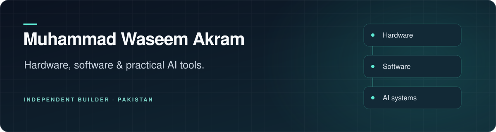

  

  <strong>Mobile hardware &amp; software engineer · Independent builder · Pakistan</strong>

  <a href="#current-focus">Current focus</a> ·
  <a href="#public-project">Public project</a> ·
  <a href="#how-i-work">How I work</a> ·
  <a href="mailto:waseemjutt814@gmail.com">Contact</a>

## About me

I'm **Muhammad Waseem Akram**. I work across mobile hardware, software, and AI tooling, with an interest in how the parts of a system connect and behave in everyday use.

My work brings together agent workflows, local tools, and developer utilities. I care about clear controls, useful diagnostics, and software that people can understand and operate.

## Current focus

### WaseemBot

An AI workspace I am developing for chat, coding assistance, and automation. My current focus is connecting its agents, tools, and runtime components through a consistent interface.

**The source is currently private.** For project questions or collaboration, [get in touch](mailto:waseemjutt814@gmail.com?subject=WaseemBot%20collaboration).

### Areas I work with

| Area | Focus |
| :--- | :--- |
| AI systems | Agent workflows, model integration, memory, and tool use |
| Software engineering | TypeScript, Python, Rust, and application integration |
| Hardware and systems | Mobile hardware, troubleshooting, and embedded systems |
| Developer tools | Source structure, diagnostics, and maintainable workflows |

## Public project

### [Error Solver](https://github.com/waseemjutt814/Error-Solver-)

A TypeScript analyzer for projects that organize source files into numbered pipelines. It checks how those files connect and provides a static HTML dashboard for reviewing the results.

- Detects broken references, duplicate IDs, missing endpoints, and orphaned files.
- Traces START-to-END flows and reports gaps or loops.
- Keeps the analysis engine separate from the application source.

[Explore the source and setup guide →](https://github.com/waseemjutt814/Error-Solver-#readme)

## How I work

- **Start with the problem.** Keep the workflow and the person using it in view.
- **Make behavior visible.** Use clear status, logs, and error messages.
- **Check the evidence.** Distinguish implemented features from work still in progress.
- **Improve the details.** Refine setup, naming, documentation, and everyday usability.

## Contact

I'm interested in conversations about practical AI tools, hardware and software integration, and developer workflows.

**Email:** [waseemjutt814@gmail.com](mailto:waseemjutt814@gmail.com)

**GitHub:** [@waseemjutt814](https://github.com/waseemjutt814)
